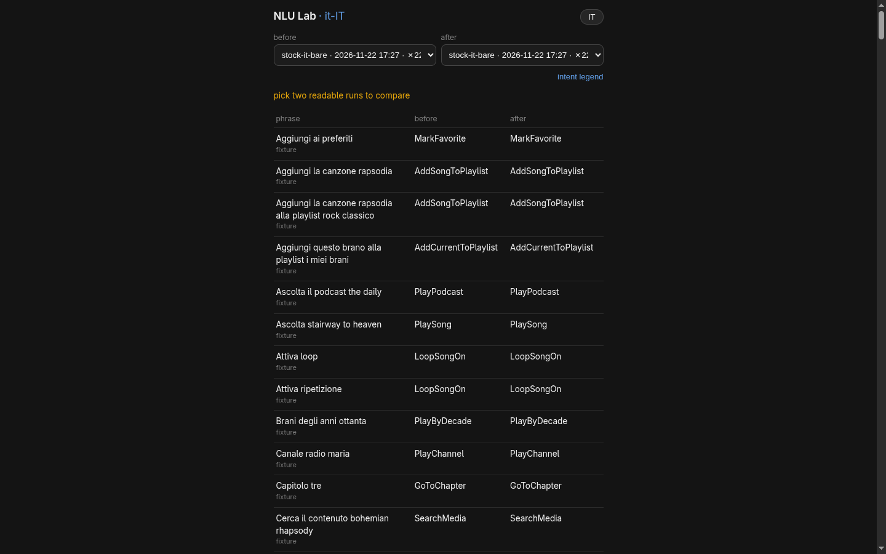
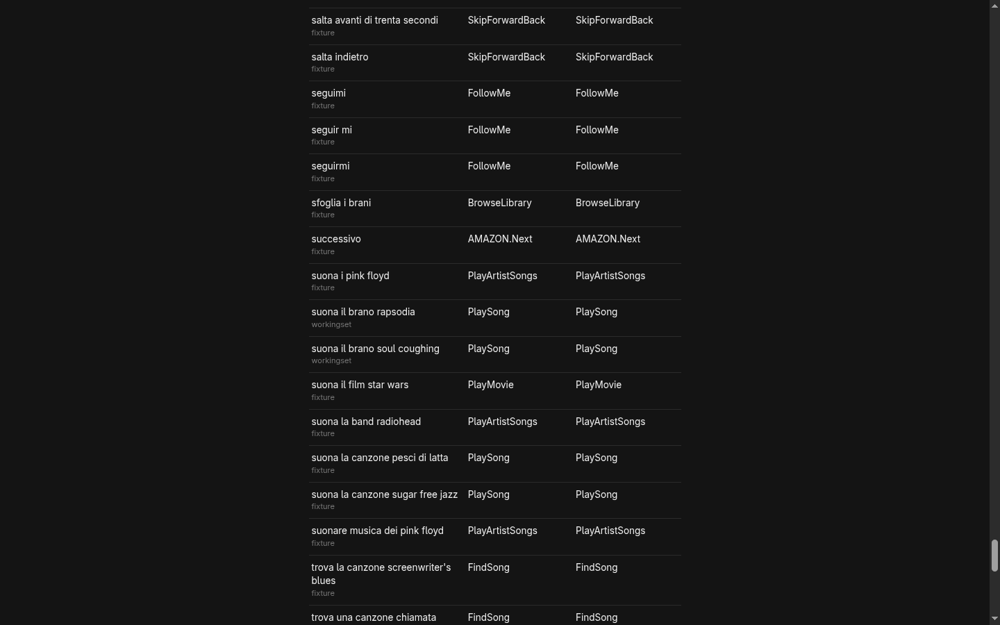

# NLU Lab: test your locale's voice model before it breaks

Think of Alexa as a mail sorting office. Every sentence you say is a letter, and each of the roughly 74 things the skill can do is a pigeonhole. The interaction model is the sorting rulebook. When you change one sorting rule (adding a word, removing a synonym), other letters can end up in the wrong pigeonhole without you noticing. The NLU Lab re-sorts the same batch of letters before and after your change, and shows you exactly which ones moved.

## Important: a green lab result does not mean it works on your skill

Your live skill carries your library's data (artist names, album titles, series names) in Amazon's catalog system. The lab skill does not. This changes how Alexa resolves competition between commands. A routing result that is correct on the lab can be wrong on your real skill. Always confirm important changes against the live skill before shipping.

## Who this is for

**If a voice command in your language goes to the wrong place**, you do not need this tool. Just tell us the phrase: open a GitHub issue saying what you said, what happened, and what you expected. Native speakers of the 15 non-English, non-Italian locales are especially valuable; you need no tooling to help.

**If you want to test model changes yourself** (a contributor, or a power user who wants to verify a fix before it ships), the lab gives you the full loop in about three minutes per iteration.

## How this tool is meant to be used: an agent sets up, you read the dashboard

The lab assumes a **split of roles**, because the setup is technical and the results are not:

- A **coding agent** (Claude Code, or any agent working in this repository) performs the setup and every iteration: authenticating the Amazon developer CLI, creating the lab skill, deploying model candidates, running the phrase batteries, comparing runs, and shipping the fix. Everything below marked "the agent" is a command the agent runs when asked.
- **You** never touch a terminal. Your entire surface is the web dashboard: the agent starts it and hands you a URL, and you read what changed. Tapping a row shows the filled slots and the alternative intents Alexa considered.

So if you reported a routing problem in your language, the way to use this tool is: ask an agent to "reproduce my issue in the NLU lab". The agent does the rest and shows you the matrix.

## Setup runbook (the agent, once per machine)

The agent needs: the `ask` CLI v2 authenticated with your Amazon developer account (`ask configure`; requires Node.js), Python 3 with `pyyaml`, and this repository cloned. The user needs a browser.

```bash
# One time: create the lab skill (pins its ID into scripts/nlu-lab/lab.json,
# the trust root every later deploy checks)
python3 scripts/nlu-lab/cli.py init-skill --endpoint "https://your-server/alexaskill"

# Noise gate before trusting anything: the same model probed twice must
# produce zero changes (see "The A/A gate" below)
python3 scripts/nlu-lab/cli.py run --template --locale de-DE --label aa-1 \
  --workingset my-phrases.yaml
python3 scripts/nlu-lab/cli.py run --template --locale de-DE --label aa-2 \
  --workingset my-phrases.yaml --skip-deploy
python3 scripts/nlu-lab/cli.py compare aa-1 aa-2 --expect-zero-changes

# Handoff: start the dashboard and give the user the URL.
# Pass an explicit port: the default 8765 can be taken by another service
# (it collided with a chat bridge on our own workstation).
python3 scripts/nlu-lab/cli.py serve --port 8877
```

From then on the user opens `http://<workstation>:8877/` whenever a new run lands; the agent can leave `serve` running or restart it per session (it is read-only over the runs directory).

## The iteration loop (the agent, every fix)

```bash
# Test the current model
python3 scripts/nlu-lab/cli.py run --template --locale de-DE --label baseline \
  --workingset my-phrases.yaml

# Edit the template, then test the change
python3 scripts/nlu-lab/cli.py run --template --locale de-DE --label after-fix \
  --workingset my-phrases.yaml

# See what changed
python3 scripts/nlu-lab/cli.py compare baseline after-fix
```

Each `run` deploys to the lab skill (never your live one), waits for Amazon's build, probes every phrase, and writes a JSON run file; the user watches the results appear in the dashboard.

## The working set: your test phrases

A YAML file with the utterances you care about:

```yaml
locale: de-DE
tests:
  - utterance: "spiele das lied mein lieblingslied"
    expected_intent: PlaySongIntent
  - utterance: "was ist das für ein lied"
    expected_intent: MediaInfoIntent
```

Leave `expected_intent` out for observation-only rows (they show as amber when they change, never red).

## Reading the comparison

```
red      spiele das lied mein lieblingslied    (workingset)
green    was ist das für ein lied             (workingset)
2 changed of 25 rows
```

- **Green**: the route changed and now satisfies its expectation (your fix worked for this phrase)
- **Red**: the route changed and now violates its expectation (your fix broke this phrase)
- **Amber**: the route changed with no expectation to judge against
- **Error**: the probe itself failed (a transient Amazon error, not a routing change)

### The A/A gate: verify the probing is noise-free

Before trusting any comparison, run the same model twice and confirm zero changes:

```bash
python3 scripts/nlu-lab/cli.py run --template --locale de-DE --label aa-1 \
  --workingset my-phrases.yaml
python3 scripts/nlu-lab/cli.py run --template --locale de-DE --label aa-2 \
  --workingset my-phrases.yaml --skip-deploy
python3 scripts/nlu-lab/cli.py compare aa-1 aa-2 --expect-zero-changes
```

If this fails, the probing is noisy and any diff is unreliable.

### What compare checks before showing results

Under `--expect-zero-changes`, the compare command refuses to show results when the two runs probed different models (sha mismatch), different Amazon builds (eTag mismatch), or different skills. Without the flag, it shows the results with a loud warning instead.

## Probing without redeploying

Amazon does not build a new model version when you deploy identical content, so deploying the same model twice will time out. Use `--skip-deploy` to probe the already-deployed model:

```bash
python3 scripts/nlu-lab/cli.py run --template --locale de-DE --label re-probe \
  --workingset my-phrases.yaml --skip-deploy
```

## The web dashboard (the user's surface)



The dashboard opens with the two run selectors (top): pick which model version is "before" and which is "after". Every phrase from the fixture suite and your working set is one row, with the intent Alexa chose on each side. The footer line summarizes how many routes changed; the `intent legend` button explains what each intent name does.



Tap any row to open its detail panel: what the phrase was expected to route to, the before/after routes, the slots Alexa filled (here the spoken title landed in the song slot), and which other intents were considered. This is usually the panel that answers "why did it go there".

The interface language switches between English and Italian. The dashboard is read-only: everything that changes state (deploys, runs) happens through the CLI on the agent's side.

## Exporting a model for the custom import

The plugin supports importing a custom interaction model via URL. To produce a deploy-ready file:

```bash
python3 scripts/nlu-lab/cli.py export --template --locale de-DE --label my-model \
  --invocation-name "my jellyfin"
```

The invocation name is required (the plugin deploys it verbatim onto your skill).

## What the lab does NOT do

- It never touches your live Jellyfin skill (a hard-coded guard checks the skill ID on every deploy)
- It does not test the actual playback pipeline
- It does not carry your library's catalog data, so routing that depends on catalog anchoring behaves differently on the lab than on your live skill (see the warning at the top)

## Known routing limitations (platform-level)

These are Alexa platform behaviors, not something the interaction model can fix. They are listed here so you do not chase them in the lab:

1. **Non-famous song titles**: for titles Amazon does not know (personal recordings, children's audio plays), the NLU cannot fill the song slot and routes elsewhere. The fix is catalog-backed song recognition (in development).

2. **Series with song-title names**: asking to watch a series whose title is also a famous recording may route to PlaySongIntent. The series-last phrasing ("schau staffel 2 folge 1 von [series]") works reliably.

3. **German compound carriers**: the sleep timer's compound carrier ("schlaf-timer") only fills the duration slot for the simplest phrases. Standard prepositional carriers ("stoppe in", "schalte aus in") work for all durations.

## A worked example: fixing the German "play song" steal

This is the real story of issue #46, from report to fix, using the lab at every step.

**The problem**: a German user reported that "spiele das lied [title]" for a children's audio play (not a famous song) was being interpreted as a question about the currently playing media instead of a request to play the song.

**Step 1: reproduce on the lab**. We created a working set with the reporter's exact phrases and ran them against the stock German model. The lab confirmed the steal: "spiele das lied die streithörnchen" routed to MediaInfoIntent instead of PlaySongIntent.

**Step 2: identify the collision**. The word "Lied" was a synonym of the MediaInfoType slot type (used for "what song is this?" questions) while simultaneously being a carrier word in PlaySongIntent samples. For titles Amazon didn't know, the NLU preferred the question intent.

**Step 3: fix and verify on the lab**. We removed "Lied" and "Song" from MediaInfoType, regenerated, deployed to the lab, and compared. The steal was gone (the phrase now fell to the neutral FallbackIntent instead of MediaInfoIntent). No other fixture regressed.

**Step 4: verify on the live skill**. We deployed the fix to the real skill and ran the NLU test suite against it. This caught a regression the lab could not see: a TV episode request that had been working now routed to PlaySongIntent, because the live skill's catalog wiring changed the NLU competition in a way the lab (without catalogs) could not reproduce. We fixed the regression and shipped.

## Technical details

- `scripts/nlu-lab/` is the tool root; `runs/` holds JSON run files (gitignored)
- The deploy guard reads `scripts/nlu-lab/lab.json` and refuses to deploy to any skill that is not the pinned lab skill
- Build-state waiting uses the SMAPI eTag as the per-build identity token, so a stale build result is never trusted
- Each run file records the model sha, the build eTag, and the skill ID, so the compare command can verify pair integrity
- The NLU fixtures live in `tests/integration/fixtures/<locale>.yaml`; the lab loads them plus your working set
- The `-k` flag filters the battery by substring (a fast iteration loop; the full de-DE battery is 83 fixture rows)
- The lab skill's manifest is created from the plugin's template, pruned of the events block and empty icon URIs (Amazon's skill creation API rejects both)
